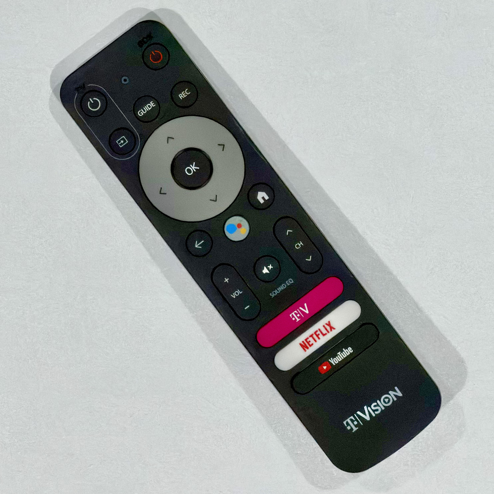
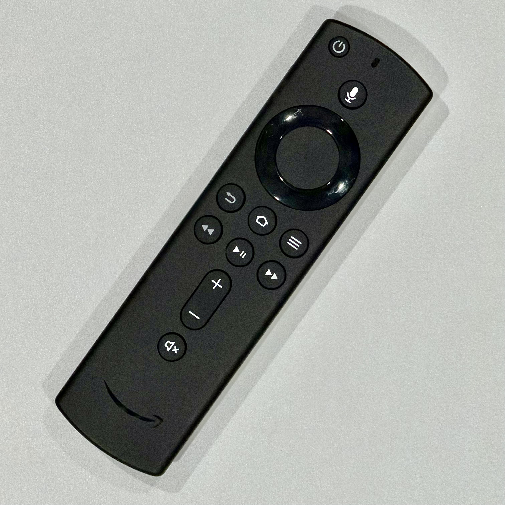

<picture>
  <source media="(prefers-color-scheme: dark)" srcset="custom_components/atvv_remote/brand/dark_logo@3x.png">
  <source media="(prefers-color-scheme: light)" srcset="custom_components/atvv_remote/brand/logo@3x.png">
  
</picture>

Use an already-paired Android TV Voice over BLE (ATVV) remote as an Assist
microphone. Home Assistant 2026.11.1 or later on Linux with a local BlueZ
adapter is required. Early development: BT19K is the physically tested model;
other supported wire formats have synthetic tests, not hardware certification.

## Install

1. Copy `custom_components/atvv_remote` into `config/custom_components`, then
   restart Home Assistant. HACS custom-repository installation is also supported.
2. Pair the remote on the Home Assistant machine itself (this integration never
   pairs remotes); see [Pairing a remote](#pairing-a-remote). Wake it with an
   arrow button before adding **ATVV Remote Voice** in Devices & Services.
3. Select the paired device and an existing Assist pipeline. Select a speaker
   and command mode in Configure when ready to process requests and hear replies.

The initial mode stops at the STT stage. This does not disable tools embedded
inside a live STT provider: such a provider may act during speech processing.
Use a dedicated transcription-only STT provider when actions must be disabled.

## Tested remotes

Remotes that speak the Android TV Voice (ATVV) protocol over Bluetooth LE can work,
plus the Fire TV voice remote below (tested for held requests). "Tested" means a person used it with this integration on real hardware;
unit tests with synthetic vectors do not count.

| | Remote | Voice protocol | Status |
| --- | --- | --- | --- |
| <a href="docs/images/bt19k-tvision-remote.jpg"></a> | BT19K (T-Mobile TVision remote) | ATVV 1.0, 16 kHz IMA ADPCM, hold-to-talk | **Tested.** Held requests, queueing, alternating conversation and replies on a media player all verified on hardware. |
| | Other ATVV 0.4 / 1.0 remotes | ATVV, 8 or 16 kHz ADPCM | Supported by protocol and covered by synthetic tests; not hardware tested. Reports welcome. |
| <a href="docs/images/fire-tv-voice-remote.jpg"></a> | Amazon Fire TV voice remote (Bluetooth LE generation, product ID `0x0413` seen) | HID-over-GATT with Opus audio, **not** ATVV | **Tested for held requests.** On one remote (product ID `0x0413`) a held request records, transcribes and plays a reply on a media player through this integration in Home Assistant OS, including after the remote sleeps and reconnects; the optional **Ignore short presses** setting removes the false failure from the wake-up tap. **Not tested:** holds longer than about 40 seconds and Alternating conversation. It needs access to `/dev/hidraw*` and an Opus decoder; see [Fire TV voice remote](#fire-tv-voice-remote). |
| | Roku voice remote (model `RC-051`) | Wi-Fi Direct to the Roku | **Not usable.** Its FCC grant lists only Wi-Fi bands and no Bluetooth band, and it was not seen advertising over Bluetooth in a scan while idle. It talks only to a Roku device. |
| | Apple Siri Remote | Apple HID-over-GATT with Opus audio | Not supported. The [SiriRemoteESP](https://github.com/Jakkumn/SiriRemoteESP) ESP32 bridge is a working alternative. |

Remotes that use Wi-Fi, infrared or RF for voice, and Bluetooth bridges that need
an ESPHome Bluetooth proxy, cannot be used: this integration needs a Bluetooth
adapter on the Home Assistant machine itself.

## Pairing a remote

This integration never creates Bluetooth bonds; pair the remote with the machine
that runs Home Assistant, then add it in Devices & Services. A remote bonds to one
host at a time, so pairing it here breaks its pairing with the TV or box it came
with (you pair it back with that device's own settings afterwards).

**Home Assistant OS** (recommended; this is the setup the integration was
developed and tested on) has two kinds of terminal. They are not the same:

| Terminal | How you reach it | Use it for pairing? |
| --- | --- | --- |
| **Host shell** ("developer SSH") | `ssh -p 22222 root@<ha-host>` after enabling it with the [developer SSH key setup](https://contributors.home-assistant.io/os/operating-system/debugging/); lands on the HA OS prompt | **Yes.** This is the route that worked for every remote paired so far. |
| **SSH / Terminal app** | `ssh root@<ha-host>` (port 22) or the web terminal; a container named `core-ssh` | Not recommended. It reaches the same Bluetooth service, but a pairing attempt from it connected and then lost its bond; the cause was not established. |

The host shell has no SFTP server, so `scp` fails. Copy a file through the SSH
connection instead:

```sh
ssh -p 22222 root@<ha-host> 'cat > /tmp/pair.sh' < pair.sh
```

Steps (a hold-to-talk remote that is awake, near the Home Assistant machine):

1. Put the remote into pairing mode as its manual describes (for many remotes,
   hold a button such as Home or a dedicated pairing key for about 10 seconds).
2. In the host shell, start `bluetoothctl` and run:

   ```text
   power on
   agent NoInputNoOutput
   default-agent
   scan on
   ```

   Wait for the remote to appear, then note its address (`<address>`). Remotes
   often use a changing private address; scan again if a pairing attempt times out.
3. Pair, trust and connect. If an `Request authorization` prompt appears, answer
   `yes`:

   ```text
   pair <address>
   trust <address>
   connect <address>
   ```

   A one-shot `bluetoothctl pair <address>` does not keep a pairing agent, so use
   the interactive prompt (or a script that keeps one session open).
4. Check `bluetoothctl info <address>` shows `Paired: yes`, `Bonded: yes` and
   `Connected: yes`. Then add **ATVV Remote Voice** in Home Assistant and wake the
   remote with an arrow button when you submit the form.

If pairing connects but does not stay bonded, put the remote back into pairing
mode (some remotes forget their old pairing only after a factory reset, described
in their manual) and try again. Do not press a remote's power buttons while testing:
on many remotes they also send infrared commands to a TV.

Home Assistant Container and Supervised installs use the same `bluetoothctl`
commands in a shell on the host; a Bluetooth adapter and BlueZ must be available
to Home Assistant itself.

## Configuration reference

Select **Configure** on the integration to change these settings; changes reload
the integration. Every setting has a short description in the form itself; this
section adds when to use each one. All text, including entity names, option
labels and error messages, comes from Home Assistant's translation files
(English is provided). Everything except the pipeline, voice mode and speaker defaults
to the behavior described in the Default column, so an existing setup does not
change unless you choose otherwise.

### Setup (once)

| Setting | What it does |
| --- | --- |
| Paired remote | A device already paired and bonded on the HA host. This integration never creates Bluetooth bonds. |
| Assist pipeline | The pipeline that processes speech: STT, conversation agent and TTS. Any pipeline works, including live speech providers. Changing it later does not need re-pairing. |

### Options

| Option | Choices | Default | Use it when |
| --- | --- | --- | --- |
| Assist pipeline | Any existing pipeline | The one chosen at setup | You want a different agent or speech provider. A removed pipeline fails with a clear error instead of silently falling back. |
| Voice mode | Transcription; Commands | Transcription | **Transcription** stops after speech recognition: nothing is run and no reply plays, which is useful for checking the microphone path and the speech provider. **Commands** runs the whole pipeline and, with a speaker, speaks the reply. |
| Reply speaker | Any media player that can play media, or none | None | You want spoken replies. Used only in Commands mode. With none, the pipeline stops at the intent stage and nothing is played. The player must report when playback starts and finishes. |
| Reply condition | Any Home Assistant conditions (state, numeric state, zone, time, template, and, or, not) | Empty (always speak) | You want a reply spoken only sometimes, for example only when you are in the room the reply speaker is in. Checked once at the start of each request. See [Reply condition](#reply-condition). |
| Reply timing | Automatic streaming; Wait for complete reply | Automatic | **Automatic** starts speaking as soon as the pipeline reports a streamed reply, which gives the earliest start if the provider produces speech faster than real time. **Wait for complete reply** plays a finished audio file: the start is later, but it avoids breakup when a provider only produces speech at about real-time pace or the speaker stutters on a live stream. Short replies may not stream at all, in which case the completed reply is played. |
| Streaming head start | 0 to 10 seconds, in 0.5 s steps | 0 | Streamed replies break up in the first seconds. After a streamed reply is ready, the integration waits this long before asking the speaker to play, or starts at once if the reply finishes sooner. It gives the speaker a lead; it cannot help if the provider keeps producing speech more slowly than it plays. It has no effect with Wait for complete reply or when the reply is not streamed. Try 0.5 to 3 seconds. |
| New press while processing | Reject; Queue one; Replace current request | Reject | A press arrives before the previous request is answered. **Reject** is the safest. **Queue one** keeps one pending request and runs it afterward. **Replace** cancels the current request so the new one starts at once; this cannot undo an action the old request already performed. |
| New press during reply | Reject; Queue one; Replace current reply | Reject | A press arrives while a reply is playing. **Reject** lets the reply finish. **Queue one** asks the next question while the reply plays and answers it afterward. **Replace** stops the reply and starts the new request. |
| Conversation context | Reuse; Fresh per request | Reuse | **Reuse** keeps the Home Assistant conversation so follow-ups such as "and double that?" work (while Home Assistant retains it). **Fresh** makes each press independent. |
| Button behavior | One request per hold; Alternating conversation while held | One request | **One request** records one request per hold and ends at release. **Alternating conversation** needs a hold-to-talk remote: speak, pause about 0.8 s, hear the reply, then speak again without releasing. |
| Ignore short presses | 0 to 0.5 seconds, in 0.05 s steps | 0 (off) | Use it with a Fire TV remote that fails with "No microphone audio" right after waking. A sleeping Fire remote re-sends the key that woke it as an instant tap, which starts and fails a request. With a value such as 0.1, a voice press shorter than that is ignored silently (no request, no failure, no Last error); a real hold starts that much later. Applies to Fire TV remotes only; other remotes ignore it. |
| Maximum request length | 5 to 120 seconds, in 5 s steps | 30 | One request is cut off too late or too early. In One-request mode it is the longest hold; in Alternating mode it bounds each turn. Lower it to stop a stuck button from recording; raise it for long dictation. Reaching it ends the request with a capture-limit error. The limit applies to every remote; remotes that are not hold-to-talk also end at about 15 seconds of speech or at silence, whichever comes first. |
| Maximum conversation length | 30 to 600 seconds, in 10 s steps | 120 | Only used in Alternating conversation mode: the longest whole hold. Must not be shorter than the request length. |

Streaming, queueing and replacement work across traditional and live pipelines.
Automatic output uses Home Assistant's streaming signals, not a provider list.
Player buffering still affects the first sound.

Queue one records one bounded pending request and processes it after the current
reply; additional requests are rejected. Pending audio expires 30 seconds after
release and is discarded on unload, disconnection or configuration change.
Replace stops the old response before starting the new one. It never
automatically retries an uncertain command. If speaker-stop ownership or
generation retirement cannot be verified, replacement fails explicitly instead
of overlapping requests or stopping unrelated media.

Alternating held mode discards input during replies to avoid treating the speaker
as a new request, and release stops further listening. This is **not simultaneous
full duplex**; talking over the reply is not supported. Full duplex is reported
unavailable because no complete pipeline interruption, player flush and
echo-reference contract is verified.

### Reply condition

With a reply speaker selected, the **Reply condition** decides whether a reply is spoken.
It uses Home Assistant's own condition editor, the same one automations use, so you can
combine state, zone, time and template conditions without writing code.

- **When it is checked:** once at the start of each request, and for each turn in
  Alternating conversation. A queued request is checked when it starts running, not
  when you pressed the button. A change after that is ignored for that request.
- **Empty** (the default) means replies are always spoken.
- **A condition that cannot be evaluated** (for example a state condition on an entity
  that does not exist, or a template error) counts as not met, like in automations,
  and is logged once.
- **What "not met" does:** the request still runs exactly as before (commands still
  execute, the conversation continues, and live and classic pipelines behave the
  same); only the spoken reply is skipped. Speech is still generated, so a skipped
  reply does not save speech-generation cost. The voice button event entity reports a
  `reply_skipped` event with the code `condition_false` or `condition_error`; it is
  not a failure and does not touch the Last error sensor. In Alternating conversation
  the next turn is ready straight away.
- **Template conditions** can use these variables. They are a stable contract:
  - `speaker`: the entity ID of the reply speaker.
  - `remote`: the name of this remote entry.
  - `held`: `true` when Button behavior is Alternating conversation.

Examples: a state condition `binary_sensor.office_occupancy` is `on` speaks only
while the office is occupied; a template condition
`{{ is_state('person.alex', 'home') and speaker == 'media_player.office' }}` ties
the rule to one speaker.

### Choosing settings by situation

- **Fast cloud model that answers quickly:** Automatic, head start 0.
- **Live speech provider whose streamed replies stutter at the start:** keep
  Automatic and raise the head start in small steps; if it still breaks up, use
  Wait for complete reply.
- **Follow-up questions in quick succession:** Reuse context, Queue one during
  reply, or Alternating conversation on a hold-to-talk remote.
- **Independent one-shot commands:** Fresh context, Reject while busy.
- **Just checking the microphone path:** Transcription mode.

### Entities

| Entity | Purpose |
| --- | --- |
| Voice (assist satellite) | Runs requests. Attributes show readiness, session, failure, rejection and queue counts, the last outcome and error, and that full duplex is unavailable. |
| Voice button (event) | Announces `pressed`, `released`, `accepted`, `rejected`, `queued`, `failed`, `context_reset` and `reply_skipped`; outcomes carry a stage, code and readable message. |
| Microphone active (binary sensor) | On while the remote is capturing audio. |
| Last error (diagnostic sensor) | The most recent failed request, or `none`. See [Reporting errors](#reporting-errors). |

## Compatibility and microphone controls

| Protocol | Audio | Voice control | Evidence |
| --- | --- | --- | --- |
| ATVV 1.0 | 8/16 kHz IMA/DVI ADPCM, headerless + sync | Hold, press-to-talk, OnRequest | BT19K 16 kHz hold tested; other combinations synthetic |
| ATVV 0.4 | 8/16 kHz IMA/DVI ADPCM, six-byte frame header | OnRequest voice notification → microphone request | ATVVoice-derived vectors; hardware untested here |
| Amazon Fire TV voice remote | HID-over-GATT; Opus 16 kHz mono, one 80-byte packet per HID report | Hold-to-talk with the microphone key; read through the kernel's `hidraw` device | Tested for held requests on one remote (product ID `0x0413`); streamed 37.8 s continuously in a probe; long holds and Alternating conversation not tested through the integration |
| Apple Siri Remote | Apple HID-over-GATT, Opus | Separate transport | Unsupported; [SiriRemoteESP](https://github.com/Jakkumn/SiriRemoteESP) is a separate ESP32 receiver option |

Capabilities choose the format; there is no model-name allowlist or key-learning
wizard. A standard voice-control notification is the trigger, so no individual
key needs teaching. Ordinary buttons that do not activate the microphone are
outside this integration. Press-to-talk is used only when advertised by the
remote; this integration does not turn BT19K's hold control into tap-to-toggle.
Unknown versions/codecs are rejected rather than guessed. See upstream
attribution in [third-party notices](THIRD_PARTY_NOTICES.md).

## Fire TV voice remote

Amazon's Bluetooth LE Fire TV voice remotes do not use ATVV. This integration reads their
voice through the kernel's HID device for the paired remote (`/dev/hidraw*`), because
BlueZ does not let applications write to the HID service. What that needs:

- **Device access.** Home Assistant must be able to open `/dev/hidraw*`. Home Assistant OS
  allows this (its core container sees and can write the node, which appears only while the
  remote is connected). Container and Supervised installs need the device passed through and
  a host kernel that provides `uhid`. A missing or unreadable device is reported as a
  translated error.
- **Opus decoder.** Home Assistant pins PyAV, whose wheel bundles libopus, so none is
  normally needed; the system `libopus` is used as a fallback. If neither exists the remote
  reports a translated error and ATVV remotes are unaffected.
- **Pairing.** Pair the remote on the Home Assistant machine itself (see
  [Pairing a remote](#pairing-a-remote)); for the Fire remote, hold Home for about 10
  seconds until the light blinks fast. Pairing it breaks its pairing with the Fire TV.
- **Limitation: lost audio cannot be detected.** The remote's reports carry no sequence
  numbers, so unlike ATVV a dropped frame cannot be noticed, and damaged audio inside a
  valid packet cannot be detected either. Packets of the wrong size or format, decoder
  failures and stalls still abort the request.
- **Waking.** The remote sleeps when idle and its entities show unavailable while its
  Bluetooth link is down; they return within about two seconds of it reconnecting. On
  the remote tested, the voice button did not wake it (another key did). The remote then
  re-sends the key that woke it about four seconds later as an instant press and release,
  which, if that key was the voice button, starts a request that fails with "No
  microphone audio". The setting **Ignore short presses** (see the configuration
  reference) filters those taps. For roughly the first minute after a wake the remote
  also started streaming audio two to four seconds late (about 0.4 s once settled), so
  the first words can be cut off: wake it with another key (not the voice button) and
  wait a few seconds before speaking.

## Behavior, privacy and limits

- Pairing, trust/bond management and Bluetooth discovery/connect ownership stay
  external. No OS packages, PipeWire daemon or proxy support are required.
- Existing Keyboard Remote and HID input integrations remain independent.
- Single-hold capture ends at release or at the configured maximum request length
  (default 30 seconds). This path disables HA's redundant end-of-speech detector,
  including its 15-second cutoff. Request/tap modes retain their local 15-second
  speech detector and ~0.8-second silence boundary. In Alternating held mode each
  turn is bounded by the maximum request length (default 30 seconds) and the whole
  hold by the maximum conversation length (default 120 seconds); the hardware may
  impose a shorter limit.
- Bad frames, unresolved sequence gaps, disconnects, queue overflow and missing
  audio abort input. Headerless audio cannot prove packet identity when CTL and
  RX counts disagree, so mismatches fail closed and record anonymous counts.
- Reconnection re-resolves GATT paths, re-subscribes and negotiates again.
  The remote may need waking. Stale busy/hold state is discarded on connection loss.
- Busy behavior is explicit and configurable. Existing pressed/released events
  remain; accepted/rejected/queued/failed/context_reset outcomes add a stage,
  code and readable reason. Satellite attributes show the current error.
- No microphone service opens capture without a physical voice notification.
- No recordings or transcripts are saved by this integration. Diagnostics omit
  identifiers/content and include capabilities, counts, errors and timings.
  Bounded history retains the last 20 captures and at most 64 anonymous boundary
  records each, so a later success does not erase the preceding failure.
  The selected pipeline/provider has its own processing and retention policy;
  cloud pipelines send speech to that provider. HA pipeline Debug can retain text.
- This integration does not change OS handling of power keys. Check host behavior
  before pressing them.

Native speech-to-speech providers can execute tools during their STT stage.
Rejecting corrupted input at the normal HA intent handoff cannot undo those
provider-side actions. Stream failures propagate as failures, never as a clean
release; uncertain actions are not retried automatically. Reusing an HA
conversation ID does not guarantee provider memory survived a cancelled session.

### Missing pipeline or speaker

If the Assist pipeline or the reply speaker you chose is later deleted or renamed,
Home Assistant shows a notice under **Settings → System → Repairs** (an error for a
missing pipeline, a warning for a missing speaker). The pipeline is checked when
Home Assistant starts and whenever you save the remote's settings, so a pipeline
deleted while running is noticed at the next restart or save (requests fail with a
clear error meanwhile). The speaker is checked live and only in Voice commands
mode, since that is the only mode that plays replies. The notice clears once you
choose an existing one in **Configure**, or the speaker returns, and it stays
dismissed if you dismissed it. A speaker that is only offline is not reported. In
**Configure**, a missing saved value stays visible with a message instead of being
replaced, and you can still save other settings.

## Reporting errors

The diagnostic **Last error** sensor is an enum sensor whose state is the
root-cause code of the most recent failed request (shown as readable text in the
Home Assistant language), `none`, or `other` for provider-defined codes. The raw
`code`, the `stage`, the `since` time and the request number (`session`) are attributes; use
the `state_translated()` template function for the readable text in automations.
It clears when a later request succeeds or the integration reloads, and stays
available while the remote is disconnected.
Busy rejections are not faults: they appear only in the voice button event and the
satellite attributes. The voice button event still announces every occurrence.

## Troubleshooting

- **No paired devices / Bluetooth unavailable:** check the host bond and HA Core
  access to local system D-Bus. A bond on another computer is insufficient.
- **Wake remote:** press an arrow, wait a few seconds, then retry. Do not use power.
- **Unsupported profile:** download redacted diagnostics and report the model,
  protocol/capabilities and integration/HA version. Do not publish addresses/audio.
- **Audio sequence gap:** retry close to the adapter; inspect last-session frame
  counters and the bounded capture history. Mismatches abort instead of being
  treated as clean EOF. This does not establish whether radio loss, notification
  ordering or another transport condition caused a particular mismatch.
- **No speech / audio stalled:** check the actual microphone control and selected
  speech-to-text provider. A normal HID key cannot substitute for mic activation.
- **No reply:** verify command mode, selected pipeline TTS and configured speaker.
  Speaker busy/unavailable and playback start/finish timeouts are distinct errors.
- **Reconnect:** wake the remote and allow up to 30 seconds for retry. Reload the
  integration if necessary; re-pair externally only when the bond itself is broken.

Physical coverage does not establish all-model compatibility or behavior under
battery depletion, radio interference, adapter removal or a host reboot.

## Acknowledgements and references

### Acknowledgements

Thanks to the open-source projects whose designs and research informed this
integration:

- [matt123p/ha-gemini-live](https://github.com/matt123p/ha-gemini-live), a Gemini
  Live integration for Home Assistant. Its documentation of streaming TTS,
  low-latency satellite playback and barge-in requirements shaped how replies are
  streamed and what is reported as unavailable here.
- [craig-b/ha-openai-realtime](https://github.com/craig-b/ha-openai-realtime), an
  OpenAI Realtime voice assistant for Home Assistant. Its playback pre-buffering
  and real-time paced delivery informed the streaming head start option.
- [b0o/ATVVoice](https://github.com/b0o/ATVVoice), a Linux daemon that turns
  Android TV voice remotes (the ATVV protocol) into a PipeWire microphone. Its
  protocol research and implementation, including the ADPCM framing, versions 0.4
  and 1.0 and the vendor handshake some remotes need, guided the ATVV support here.
- [Jakkumn/SiriRemoteESP](https://github.com/Jakkumn/SiriRemoteESP), an ESP32
  receiver for the Apple Siri Remote with ESPHome and MQTT. It is the working
  option for that remote today, and its microphone and Assist lifecycle informed
  how a remote's voice is handled.
- [justanotheruseer/fire-remote-client](https://github.com/justanotheruseer/fire-remote-client)
  and [Staars/berry-examples](https://github.com/Staars/berry-examples)
  (`ble/ble_fireRC.be`), with the write-up
  [Fire TV remote BLE voice](https://reversedwithai.com/p/fire-tv-remote-ble-voice).
  They reverse-engineered the Amazon Fire TV voice remote (HID-over-GATT, report
  `0xF0` audio, `0xF2` microphone enable, Opus), which this integration then
  confirmed on hardware.

The ATVV protocol and IMA/DVI ADPCM implementation was adapted with reference to
ATVVoice (MIT; its copyright notice and licence text are in
[THIRD_PARTY_NOTICES.md](THIRD_PARTY_NOTICES.md)). From the other projects only
ideas, protocol facts and design lessons were taken; no source code was copied.

### Useful references

For pairing and Bluetooth setup:

- [Home Assistant Bluetooth integration](https://www.home-assistant.io/integrations/bluetooth/)
  (adapters and Bluetooth proxies; proxies cannot be used by this integration).
- [Home Assistant Keyboard Remote integration](https://www.home-assistant.io/integrations/keyboard_remote/):
  its prerequisites say to pair a Bluetooth remote with the operating system first,
  which is the same first step as here. It has no `bluetoothctl` walkthrough.
- [Debugging the Home Assistant Operating System](https://contributors.home-assistant.io/os/operating-system/debugging/)
  (enabling the host shell on port 22222).
- [ArchWiki: Bluetooth](https://wiki.archlinux.org/title/Bluetooth) for a general
  `bluetoothctl` walkthrough that applies to any BlueZ system, and the
  [BlueZ project](https://www.bluez.org/).

## Development and releases

Linux/Python 3.14 is the reference test environment. Install
`requirements-dev.txt` in a virtual environment, then run:

```sh
PYTEST_DISABLE_PLUGIN_AUTOLOAD=1 python -m pytest -p pytest_asyncio.plugin
ruff check .
ruff format --check .
python scripts/check_package.py
```

CI runs the full HA setup/unload test on Linux. Synthetic tests cover both
protocol versions, frame validation, microphone lifecycle, reconnect reset,
configuration, real Core speech-stream duration, early playback, both-stage busy
policies, queue expiration, held logical turns and owned speaker cancellation.
New streaming/held behaviors need physical acceptance testing before a hardware
compatibility claim; unit tests alone do not establish acoustic latency. macOS may have an upstream HA/native
extension shutdown crash; use Linux for the complete lifecycle suite.

For contributions, supply synthetic protocol vectors and failing regression
tests before changing framing/decoder behavior. Include upstream revision and
license attribution. Keep personal configuration, packet captures, recordings,
credentials, deployment notes and research outside this repository. Verify new
remote models physically before upgrading their compatibility claim.

`scripts/check_package.py` creates `dist/atvv_remote.zip` containing only component
files. No public release or publishing is performed automatically.

## Branding

The Emerald Solar icon combines a voice remote, a speech bubble and two motion
strokes. Its transparent artwork uses forest `#10332C`, emerald `#25B981` and
warm gold `#E8B64F`, with the same palette for light and dark backgrounds.

The editable [icon SVG](docs/images/icon.svg),
[light wordmark SVG](docs/images/logo.svg),
[dark wordmark SVG](docs/images/dark_logo.svg) live in `docs/images/`.
Home Assistant's required PNG exports live in
[`custom_components/atvv_remote/brand/`](custom_components/atvv_remote/brand/).
Home Assistant loads these local brand images automatically; no extra setup is needed.

The README uses the 3× wordmarks (3540 × 768) from that same `brand/` folder;
Home Assistant uses its required normal and 2× variants. No duplicate PNG exports
are kept in `docs/images/`.

Install [librsvg](https://gnome.pages.gitlab.gnome.org/librsvg/) to provide
`rsvg-convert`, then regenerate all PNGs from the three SVG sources:

```sh
scripts/generate_branding.sh
```

The script generates normal, 2× and 3× variants of the icon and both wordmarks
in `brand/`. It resolves paths relative to itself, so it can also be invoked by
its full path from another working directory.
